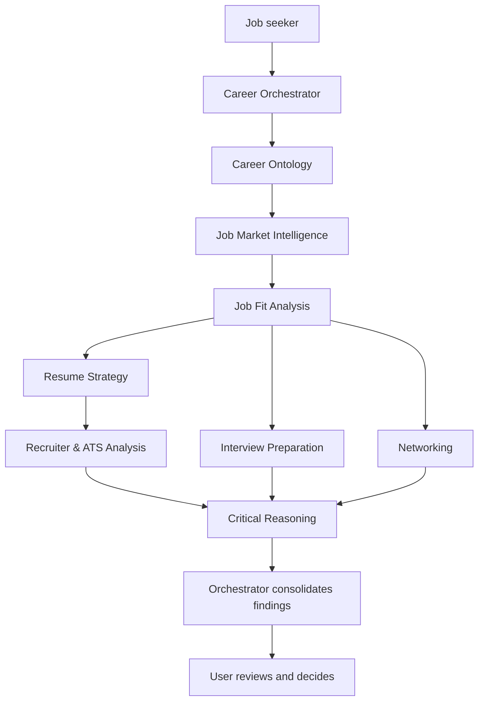

# Hive & Seek

**Your career. Your logic. Your swarm.**

Hive & Seek is an **Ontology-Driven Multi-Agent System (OD-MAS)** for career intelligence and job searching. Its design brings together nine specialist agents, a shared career knowledge model, and an explicit record of the reasons behind decisions.

The goal is to help a person find opportunities that fit both their demonstrated capabilities and the work they actually want to do. Recommendations should explain the evidence, identify gaps, challenge weak assumptions, and preserve what was learned for the next decision.

**Project status: documentation and design foundation.** The repository includes specifications, nine agent contracts, a portable prompt, reusable templates, and a synthetic walkthrough. Application code, independently executing agents, integrations, hosting, and an installed AI-DLC runtime are future work. Capabilities described below are the intended behavior unless identified as an artifact available today.

## Contents

- [Quick start](#quick-start)
- [Why Hive & Seek](#why-hive--seek)
- [What ontology-driven means](#what-ontology-driven-means)
- [The nine agents](#the-nine-agents)
- [How the agents work together](#how-the-agents-work-together)
- [Execution throttle and efficiency](#execution-throttle-and-efficiency)
- [The career workflow](#the-career-workflow)
- [An example decision](#an-example-decision)
- [Two layers: building the system and using it](#two-layers-building-the-system-and-using-it)
- [Where AI-DLC fits](#where-ai-dlc-fits)
- [Evidence, decisions, and memory](#evidence-decisions-and-memory)
- [Human control and private data](#human-control-and-private-data)
- [Evaluation and success measures](#evaluation-and-success-measures)
- [Roadmap](#roadmap)
- [Repository layout](#repository-layout)
- [Documentation guide](#documentation-guide)
- [Frequently asked questions](#frequently-asked-questions)
- [Contributing and licensing](#contributing-and-licensing)

## Quick start

You can explore the approach today without installing an agent framework or selecting a cloud platform. The available starting point is a guided conversation supported by the prompt and templates.

### 1. Read the concept or inspect a complete example

Start with the [vision and scope](docs/product/vision-and-scope.md) for the product definition, or the [synthetic pilot](examples/synthetic/pilot.md) to see how evidence, preferences, fit analysis, drafting, critique, and a decision record connect.

The example uses a fictional candidate and fictional opportunity. It demonstrates the design; it is not a live job recommendation or a completed agent run.

### 2. Use the career architect prompt

Open [Hive & Seek Career Architect](prompts/hive-and-seek-career-architect.txt) and copy the master prompt into your preferred LLM. The persona begins with career discovery: what information already exists, what the person wants to achieve, and what problem the system should solve.

An initial request can be as simple as:

> Help me build my career ontology from the materials I provide. Capture my experience, evidence, motivations, constraints, and the reasons behind my preferences. Preserve the nine distinct agent roles. Begin with discovery, identify missing information, and distinguish confirmed facts from your inferences.

A conversation can simulate the nine roles. Actual browsing, persistent storage, separate agent execution, and account access depend on capabilities supplied by the host environment; the prompt itself does not provide them.

### 3. Create your records in a private workspace

Use the [career discovery template](templates/career-discovery.md), [evidence register](templates/evidence-register.csv), and [decision record](templates/decision-record.md). Start with materials you already have, such as a resume, accomplishment notes, role descriptions, and job-search feedback. Record the sources and clarify uncertainty rather than repeatedly rebuilding context from memory.

Keep completed records outside this public repository. The checked-in templates are blank; public examples are synthetic.

### 4. Complete one bounded pilot

Choose one target role category and one supplied or verifiable opportunity. Follow the [career pilot workflow](workflows/career/pilot.md) to produce a fit assessment, an evidence-backed application draft, critical review, and a concrete next step.

The first milestone is a useful, reviewable decision packet. It does not require autonomous outreach, a deployed application, or every agent participating in every task.

## Why Hive & Seek

Career decisions depend on more than matching a resume to a job description. A person may be qualified for a role they would dislike, interested in a role with a material skill gap, or overlooking adjacent opportunities because their experience is described too narrowly.

The reasoning behind these judgments is often scattered across conversations and documents. A resume records selected experience. A job tracker records applications. Neither necessarily explains why a responsibility is attractive, why a constraint matters, or what would change the person's decision.

Hive & Seek is designed to connect that context and carry it across the search:

- **Understand the person:** experience, accomplishments, motivations, goals, preferences, and exclusions.
- **Preserve the reasons:** why criteria matter, what tradeoffs are acceptable, and which assumptions remain uncertain.
- **Coordinate specialist work:** research, fit analysis, application strategy, screening analysis, interview preparation, and networking.
- **Challenge conclusions:** test favorable and unfavorable judgments against evidence and alternatives.
- **Learn through explicit updates:** record corrections and observed outcomes without silently rewriting preferences or history.

Every recommendation should answer four questions:

| Question | What the answer should contain |
| --- | --- |
| Can the person do the job? | Demonstrated capabilities, transferable experience, requirement mapping, and gaps |
| Would the person want the job? | Motivations, responsibilities, constraints, working conditions, and tradeoffs |
| How strong is the evidence? | Sources, verification, freshness, contradictions, and unknowns |
| What should happen next? | A specific action supported by the assessment and the user's authorization |

The hypothesis is that explicit decision context and specialist challenge improve relevance and reduce repeated explanation. The project will evaluate that hypothesis against a simpler single-assistant baseline.

## What ontology-driven means

An ontology makes the important concepts and relationships explicit. In Hive & Seek, this includes experience, capabilities, accomplishments, motivations, preferences, constraints, opportunities, evidence, and decisions.

The value comes from the connections. An accomplishment may demonstrate a capability. A motivation may explain a preference. A job requirement may match a capability while a working condition conflicts with a hard constraint. A recommendation should retain those links so the user can inspect the reasoning and correct it.

| Knowledge category | What it captures | Why it matters |
| --- | --- | --- |
| Professional identity and experience | Roles, responsibilities, projects, scope, and career narrative | Establishes what the person has actually done |
| Capabilities and accomplishments | Skills, behaviors, outcomes, recency, and supporting evidence | Grounds qualification claims and application materials |
| Motivations and preferences | Enjoyed work, desired conditions, importance, and reasons | Explains what makes an opportunity desirable |
| Constraints and exclusions | Non-negotiable conditions, scope, exceptions, and confirmation | Prevents a strong skills match from overriding an unacceptable condition |
| Opportunities and market signals | Requirements, observed status, source dates, and patterns | Connects personal context to external evidence |
| Decisions and search history | Alternatives, assumptions, tradeoffs, outcomes, and revisions | Preserves context and supports deliberate improvement |

For example, a fictional accomplishment such as coaching facilitators can support a mentoring capability. A separate statement that the person enjoys developing colleagues can support a preference for mentoring responsibilities. The accomplishment alone does not prove that preference; the distinction remains visible.

The [ontology model](ontology/model.md) defines entities, relationships, provenance, and versioning. The [decision rules](ontology/decision-rules.md) explain how constraints, desirability, capability, and uncertainty affect a recommendation. The current model is human-readable; no graph database or formal ontology language has been selected.

## The nine agents

The architecture baseline contains **nine distinct agents**. Each has its own contract, responsibility, inputs, outputs, and boundaries.

| Agent | Primary responsibility | Main inputs | Typical outputs |
| --- | --- | --- | --- |
| [Career Ontology](agents/career/ontology.md) | Maintain connected career knowledge and decision history | Career sources, user statements, evidence, corrections | Discovery profile, ontology snapshots, evidence relationships, conflict and change records |
| [Job Market Intelligence](agents/career/market-intelligence.md) | Find and assess opportunity information | Target categories, criteria, available research tools, prior listings | Opportunity briefs, requirement evidence, source dates, status and freshness limitations |
| [Job Fit Analysis](agents/career/fit-analysis.md) | Assess capability and desirability separately | Approved ontology, opportunity evidence, constraints and preferences | Requirement mapping, fit assessment, gaps, tradeoffs, proposed next step |
| [Resume Strategy](agents/career/resume-strategy.md) | Prepare truthful, targeted application materials | Supported career evidence, source resume, opportunity requirements | Resume or cover-letter drafts, change explanations, claim-to-evidence mapping |
| [Recruiter & ATS Analysis](agents/career/ats-analysis.md) | Analyze screening criteria and how experience is presented | Listing requirements, draft materials, verified capabilities | Screening checklist, terminology suggestions, missing-evidence questions |
| [Interview Preparation](agents/career/interview-preparation.md) | Prepare role-specific discussion and practice | Opportunity, fit gaps, career stories, available interview context | Practice questions, evidence-backed talking points, employer questions, post-interview review |
| [Networking](agents/career/networking.md) | Plan relevant outreach and prepare drafts | Authorized contact context, goals, opportunity and career narrative | Outreach strategy, recipient context, messages for review |
| [Critical Reasoning](agents/career/critical-reasoning.md) | Challenge evidence, assumptions, recommendations, and drafts | Task question, approved criteria, evidence, proposed outputs | Counterarguments, required corrections, alternative interpretations, remaining dissent |
| [Career Orchestrator](agents/career/orchestrator.md) | Route work and present a coherent result | User objective, ontology version, task ledger, specialist findings | Assignments, consolidated review packet, unresolved questions, next-action and outcome records |

The orchestrator invokes the agents relevant to a task. An interview agent can remain idle during opportunity intake while still being part of the architecture. A guided conversation may simulate all nine roles, but each responsibility and handoff remains distinct.

Nine logical agents do not require nine model instances, and these files do not instantiate running agents. Adding, merging, removing, or deferring baseline agents requires a documented architecture change approved by the project owner. See the [agent catalogue](agents/README.md) and [nine-agent decision record](docs/decisions/0003-nine-agent-baseline.md).

## How the agents work together

The Career Orchestrator coordinates work against a shared, approved ontology version. A task has a clear objective, one owner, relevant inputs, allowed tools, dependencies, and an expected output. Findings return with source references, uncertainty, and the context version used.

The following diagram illustrates possible handoffs in a career cycle. It shows all nine agents; it does not require every path to run for every opportunity or prescribe a runtime execution order.

The coordination design addresses several common failure modes:

- **Duplicate work:** check existing tasks and opportunity identities before assigning new research.
- **Conflicting context:** pin an ontology snapshot and revalidate affected outputs when it changes.
- **Unclear responsibility:** keep fit assessment, drafting, screening, interview preparation, networking, and critique under their separate contracts.
- **Manufactured consensus:** retain material dissent and explain how objections were resolved or left open.
- **Uncontrolled work:** define effort limits and, for a future runtime, bounded retries, recovery, and action permissions.

Critical review should form an initial view from the question, criteria, and evidence before seeing the recommendation where practical. A critique simulated in the same conversation must be labeled accurately; it is not proof of independent execution.

See the [coordination protocol](docs/architecture/coordination.md) and [handoff template](templates/agent-handoff.md) for the detailed contract.

## Execution throttle and efficiency

The proposed **resource governor** puts bounds around the career workflow. The Career Orchestrator selects relevant work; the governor determines whether it may execute within the selected capacity, call, token, monetary, retry, review, and time allowances.

This is a runtime component, **not a tenth agent**. All nine agents remain available, and idle roles do not consume execution slots. Every executing instance and model/tool request must pass admission checks, including orchestration calls and delegated work. Enforcement belongs in orchestration software; instructions asking an LLM to be economical cannot supply it.

| Control | Illustrative pilot setting | Purpose |
| --- | --- | --- |
| Concurrent workers | 3 per root workflow | Queue excess work without merging or removing roles |
| Aggregate calls | 24 model attempts and 12 tool attempts | Bound sequential work as well as parallel work, including retries and critique |
| Aggregate model tokens | 60,000 input/output tokens, including billed reasoning where applicable | Prevent individual tasks from collectively exceeding one shared allowance |
| Retry / review limits | 1 task retry; 2 additional review/revision rounds per artifact lineage | Bound repeated failures and discussion loops |
| No-progress limit | 2 consecutive non-progress review/revision rounds | Pause repetitive work that adds no material evidence or correction |
| Time limits | 90 seconds per call; 300 per task; 900 accumulated workflow execution seconds | Bound stalled work and preserve elapsed time across resumes |
| Monetary budget | Must be selected with currency and a pricing basis | Reserve known model/tool costs; do not treat unknown usage as free |

These numbers are **illustrative proposals, not active defaults or measured optimal values**. The [reference policy](examples/synthetic/resource-policy.json) is non-executable example data with monetary settings intentionally unset. The current repository contains no throttle implementation.

The governor uses one durable ledger for the root workflow and all descendants. Before dispatch, it must atomically reserve conservative usage estimates against consumed resources and outstanding reservations. This prevents simultaneous agents from each spending the same remaining budget. Resume and retry retain counters rather than creating new allowances.

Efficiency also depends on relevant-agent routing, duplicate detection, permission/freshness-aware evidence reuse, and task-specific context. Context trimming must preserve material constraints and contrary evidence. Additional work cannot be justified merely by producing longer text or more agent agreement.

When a hard limit is reached, stop new dispatch, reconcile in-flight operations, preserve completed artifacts, and pause with unfinished work clearly identified. Required critique, privacy, career constraints, and action approvals cannot be skipped to fit the budget. Unknown external-action results must be reconciled before retrying. Agents cannot raise their own limits.

See the [resource-governor specification](docs/architecture/resource-governor.md), [budget record](templates/resource-budget.md), and [design decision](docs/decisions/0004-resource-governor.md). Numerical operating limits and service-wide ceilings must be selected before governed execution; manual role-play without reliable metering is labeled advisory.

## The career workflow

The portable persona guides a person through discovery, knowledge construction, architecture, implementation planning, a validated pilot, and improvement. Within a job-search cycle, the practical outputs are:

| Step | Work | Reviewable artifact |
| --- | --- | --- |
| Discover | Reuse existing materials and clarify goals, motivations, criteria, and reasons | Career discovery profile with gaps and source references |
| Build the knowledge baseline | Connect claims, capabilities, preferences, constraints, and evidence | Approved ontology snapshot, evidence register, and decision log |
| Research | Inspect supplied listings or research opportunities with available tools | Opportunity brief with requirements, source dates, and verification limits |
| Assess | Check hard constraints and separate capability from desirability | Fit report with gaps, uncertainty, and tradeoffs |
| Prepare | Draft relevant application materials; add interview or outreach preparation when needed | Versioned drafts and evidence mapping under separate agent contracts |
| Challenge and decide | Review assumptions, unsupported claims, and alternative interpretations | Consolidated packet, critique disposition, and decision record |
| Follow through and improve | Record actual actions, feedback, outcomes, and confirmed corrections | Approval/outcome records and proposed ontology changes |

A draft-only pilot stops at a complete review packet. Tool-enabled outreach or application submission is a separate action that requires explicit approval. Later feedback can change the ontology, but the reason for the change and the previous judgment remain traceable.

The [pilot workflow](workflows/career/pilot.md) provides the step-by-step procedure. The [continuous improvement workflow](workflows/career/continuous-improvement.md) covers corrections, outcome review, and changes to shared knowledge.

## An example decision

Consider Avery, a fictional candidate who has designed onboarding workshops and coached facilitators. Avery enjoys mentoring and has a confirmed limit of one travel day per month.

A fictional customer education role includes facilitator coaching and “occasional travel,” without defining frequency.

| Dimension | Assessment | Reason |
| --- | --- | --- |
| Capability | Relevant evidence for workshop design and coaching | Supported accomplishments match part of the work; other requirements still need review |
| Desirability | Promising mentoring alignment | The responsibility matches a stated motivation |
| Hard constraint | Unresolved | “Occasional” does not establish compliance with the travel limit |
| Recommendation | Clarify before pursuing unconditionally | A skills match cannot resolve an unknown working condition |

Resume Strategy can draft a paragraph grounded in the workshop and coaching evidence. Recruiter & ATS Analysis can inspect it against known criteria. Networking can prepare a travel-clarification question, and Critical Reasoning can challenge any overstatement of overall fit. The orchestrator assembles the findings for the user's decision.

If later evidence establishes four travel days per month, the recommendation changes under the current constraint. The system should preserve both decisions and explain why it revised the assessment, rather than silently replacing the earlier record.

All details are synthetic. See the [full walkthrough](examples/synthetic/pilot.md) for record IDs, handoffs, draft evidence, and revision history.

## Two layers: building the system and using it

The project separates development orchestration from career operations. This distinction keeps engineering work, personal knowledge, permissions, and runtime responsibilities clear.

| Layer | Purpose | Agents and records | Current state |
| --- | --- | --- | --- |
| Development system | Design, build, review, and eventually operate Hive & Seek | Development specialists, requirements, contracts, architecture decisions, work units, verification evidence | Planning artifacts available; AI-DLC adoption proposed |
| Career system | Help a person understand opportunities and make career decisions | The nine career agents, private ontology, evidence, drafts, approvals, outcomes | Contracts, prompt, templates, and synthetic example available |

Development agents can build an orchestrator, storage layer, or integration. The career agents use the resulting product to serve a job seeker. Their state and permissions are separate: approving engineering work does not authorize sending a career message or sharing private candidate data.

See the [architecture blueprint](docs/architecture/overview.md) and [development role map](agents/development/roles.md).

## Where AI-DLC fits

[AWS Labs AI-DLC Workflows](https://github.com/awslabs/aidlc-workflows) is the proposed development method for building Hive & Seek. Its structured lifecycle, development specialists, persistent knowledge, review gates, and audit mechanisms are relevant to keeping requirements, design, implementation, and verification connected.

It does not by itself supply the career ontology, job-search integrations, or career runtime. Those remain product-specific design and implementation work.

| AI-DLC phase | Application to Hive & Seek | Intended result |
| --- | --- | --- |
| Initialization | Establish the actual development workspace and intent when tooling is adopted | Tool-generated state and real workflow records |
| Ideation | Review the career problem, feasibility, scope, and pilot objective | Clear intent and bounded product goals |
| Inception | Refine requirements, ontology, contracts, dependencies, and delivery units | Reviewed design and implementation plan |
| Construction | Build and verify the smallest useful integrated slice | Executable behavior with current review and test evidence |
| Operation | Establish privacy, recovery, cost controls, observability, and feedback | An operable runtime when implementation and deployment are authorized |

The proposed approach is to prove a small integrated slice before expanding infrastructure. Parallel development may be useful for genuinely independent work after interfaces, dependencies, and verification are reliable. It is a development option, not an assumption that the career agents already run concurrently.

The [AI-DLC adoption plan](workflows/development/ai-dlc-adoption.md) records the reviewed upstream snapshot, reuse boundaries, and setup sequence. The files in [aidlc-docs/](aidlc-docs/README.md) are human-authored planning inputs. They are not engine-generated state or evidence of completed AI-DLC stages. A release, harness, provider, and setup approach remain open choices.

## Evidence, decisions, and memory

The intended memory model preserves the difference between what was stated, what was observed, and what an agent inferred. A claim carries its source, date, verification state, and limitations. A relationship can also be an inference: evidence of leadership does not automatically establish a preference for management.

A substantive decision record captures:

- The question, context, selected option, and concise rationale.
- Supporting and conflicting evidence, with source references.
- Applicable preferences, hard constraints, assumptions, and unknowns.
- Alternatives, tradeoffs, confidence, and the decision maker.
- Observed outcomes and the reason for any later revision.
- Dependent outputs that need revalidation after a change.

Agents work from a named ontology snapshot. The ontology role consolidates proposed changes, and the user confirms changed preferences, constraints, and disputed personal facts. Prior decisions are superseded with links and reasons; they are not silently erased.

“Learning” here means explicit updates to knowledge and decision rules from reviewed corrections and observed outcomes. It does not imply model retraining, automatic permanent memory, or background activity. The records capture reviewable reasons and evidence, not private model chain-of-thought.

Use the [evidence register](templates/evidence-register.csv), [decision record](templates/decision-record.md), and [ontology change template](templates/ontology-change.md).

## Human control and private data

The user owns the final career claims, preferences, and external actions. Drafting a message is separate from sending it. Preparing an application is separate from submitting it.

| Activity | Intended boundary |
| --- | --- |
| Analyze supplied career material | Work within the authorized task and use only necessary context |
| Research opportunities | Use actually available, authorized tools; record sources and freshness limits |
| Draft applications or outreach | Produce reviewable drafts grounded in evidence |
| Change personal preferences or exclusions | Seek confirmation and retain the reason and prior version |
| Send outreach or submit an application | Require explicit approval tied to the concrete destination and payload |
| Share private information with another service | Require authorization for that data and destination |

This is a public repository. Real resumes, contact records, correspondence, interview transcripts, personal ontology instances, derived embeddings, and private logs belong in separately controlled storage. Removing a name alone does not make a real career history suitable as a public example.

External job descriptions and documents are evidence to inspect, not instructions that can grant permissions or redirect an agent. A future implementation must enforce these boundaries rather than rely on prompt wording alone.

See [privacy and permissions](docs/architecture/privacy-and-permissions.md), the [data boundary](data/README.md), and the [approval record template](templates/approval-record.md).

## Evaluation and success measures

The project should be judged by useful decisions and outcomes, including the effort and cost required to produce them. More agents, more generated text, or more applications are not sufficient evidence of value.

| Area | Measures to record |
| --- | --- |
| Relevance | User-rated opportunity quality, with reasons and sample counts |
| Truthfulness | Evidence coverage, unsupported claims, and corrections required |
| Constraint handling | Known violations, unresolved conditions, and inappropriate overrides |
| Effort | User time, elapsed time, and repeated explanation |
| Coordination | Duplicate tasks, avoidable retries, and material value of critique |
| Resource governance | Peak concurrency, total model/tool attempts, reservations and reconciled usage, limit events, no-progress stops, and partial-work status |
| Cost | Measured or explicitly estimated model/tool usage with a dated pricing basis |
| Search outcomes | Applications, interviews, offers, observation windows, and pending outcomes |

Use comparable inputs and evaluation criteria for the nine-role workflow and a simpler single-assistant baseline. Report missing measurements and small sample limitations. An interview or rejection may have many causes; the system should not invent causality or guarantee hiring results.

The [acceptance scenarios](evaluation/acceptance-scenarios.md) define expected behavior for evidence, hard constraints, permissions, untrusted inputs, execution honesty, recovery, and preservation of the nine-agent baseline. They are specifications, not passing runtime test results. See the [scorecard](evaluation/scorecard.md) and [requirements traceability](aidlc-docs/inception/traceability.md).

## Roadmap

| Milestone | Focus | Current state |
| --- | --- | --- |
| Foundation | Documentation, nine agent contracts, prompts, templates, and conceptual design | Available in this repository |
| Discovery and ontology | Private career profile, evidence register, reviewed ontology snapshot | Not started as a project pilot |
| Guided pilot | One role category and one complete review packet using the nine-agent baseline | Planned |
| Implementation design | Select representation, private storage, execution mode, tools, and budget | Open |
| Working slice | Implement the smallest end-to-end flow and verify actual behavior | Deferred |
| Persistent execution | Add tool-backed specialist execution, checkpoints, and bounded recovery where justified | Deferred |
| Expansion | Extend workflows and integrations for the nine agents based on measured need | Deferred |

All nine agents remain in the architecture throughout these milestones. Task routing determines which agents participate in a particular packet. Changes to the baseline require an explicit approved architecture decision.

No delivery dates, cloud platform, model provider, agent framework, graph database, or project license have been selected. See the [detailed roadmap](docs/product/roadmap.md), [technology options](docs/architecture/technology-options.md), [backlog](aidlc-docs/inception/backlog.md), and [planning state](aidlc-docs/planning-state.md).

## Repository layout

| Folder or file | Contents |
| --- | --- |
| [docs/](docs/README.md) | Product definition, architecture, privacy, glossary, and architecture decisions |
| [ontology/](ontology/README.md) | Concepts, relationships, provenance, versioning, and decision rules |
| [agents/](agents/README.md) | Nine career agent contracts and separate development responsibilities |
| [workflows/](workflows/README.md) | Career pilot, continuous improvement, and AI-DLC adoption procedures |
| [aidlc-docs/](aidlc-docs/README.md) | Human-authored intent, requirements, backlog, traceability, and future delivery planning |
| [prompts/](prompts/README.md) | Portable career architect persona and usage context |
| [templates/](templates/README.md) | Blank discovery, evidence, decision, change, handoff, resource-budget, fit, approval, and outcome records |
| [examples/synthetic/](examples/synthetic/pilot.md) | Fictional end-to-end walkthrough with evidence and decision revisions |
| [evaluation/](evaluation/README.md) | Acceptance scenarios and quality, outcome, effort, and cost measures |
| [data/](data/README.md) | Public/private data guidance; no real candidate records |
| [src/](src/README.md) | Reserved location for future application source |
| [tests/](tests/README.md) | Reserved location for future executable verification |
| [AGENTS.md](AGENTS.md) | Instructions for AI-assisted repository work |
| [CONTRIBUTING.md](CONTRIBUTING.md) | Contribution scope, evidence, review, and licensing guidance |

## Documentation guide

| If you want to… | Start here |
| --- | --- |
| Understand the problem and product boundaries | [Vision and scope](docs/product/vision-and-scope.md) |
| Try the guided approach | [Career architect prompt](prompts/hive-and-seek-career-architect.txt) and [career pilot](workflows/career/pilot.md) |
| See a complete example | [Synthetic walkthrough](examples/synthetic/pilot.md) |
| Understand career knowledge and decision rules | [Ontology model](ontology/model.md) and [decision rules](ontology/decision-rules.md) |
| Inspect the nine roles | [Agent catalogue](agents/README.md) |
| Design handoffs and shared-state updates | [Coordination protocol](docs/architecture/coordination.md) |
| Understand execution limits and spending controls | [Resource governor](docs/architecture/resource-governor.md), [reference policy](examples/synthetic/resource-policy.json), and [budget record](templates/resource-budget.md) |
| Review the technical direction | [Architecture blueprint](docs/architecture/overview.md) and [technology options](docs/architecture/technology-options.md) |
| Plan development with AI-DLC | [Adoption plan](workflows/development/ai-dlc-adoption.md) and [development artifacts](aidlc-docs/README.md) |
| Review intended behavior and evaluation coverage | [Requirements](aidlc-docs/inception/requirements.md), [traceability](aidlc-docs/inception/traceability.md), and [acceptance scenarios](evaluation/acceptance-scenarios.md) |
| Create private working records | [Template index](templates/README.md) |
| Understand accepted and open decisions | [Decision index](docs/decisions/README.md) |
| Find terminology | [Glossary](docs/product/glossary.md) |

## Frequently asked questions

### Is this runnable software?

The repository currently provides the design and materials for a guided pilot. There is no application package, installation command, deployed service, or configured agent runtime. The portable prompt can guide a conversation in an LLM with suitable capabilities.

### Are all nine agents included from the start?

Yes. All nine have distinct contracts and remain the architecture baseline. An agent can be available without receiving a task in every workflow. Simulating the roles in one conversation preserves those boundaries; it does not turn them into independently running processes.

### Does an ontology require a graph database?

The first pilot can use private, versioned Markdown and CSV records with explicit concepts and relationships. Formal schemas, databases, graph representations, or retrieval infrastructure can be selected later if a demonstrated requirement justifies them.

### What prevents too many agents or excessive spending?

The design specifies a resource governor around the orchestrator: a fixed nine-role roster, bounded executing instances, shared aggregate allowances, atomic reservations, loop/time limits, and safe pause/resume. It is documented rather than implemented. Defining nine roles does not require running all nine at once, and no agent can independently expand the roster or raise limits.

### Will it automatically find jobs, send messages, or apply for me?

The current artifacts do not perform background actions. Research depends on available tools. Sending messages, submitting applications, or sharing private data requires the appropriate integration and explicit authorization for the concrete action. Draft preparation alone does not authorize delivery.

### Is AI-DLC required to use the prompt?

The portable prompt and templates can support a guided career conversation without installing AI-DLC. AI-DLC is proposed for developing the eventual product; adopting it is a separate engineering decision and setup task.

### What happens when the information is uncertain or changes?

Unknowns remain visible. Source dates and verification limits accompany changing opportunity facts. Personal corrections create reviewed knowledge changes, and affected recommendations are revalidated. The original reasons and prior judgments remain traceable.

## Contributing and licensing

Read [CONTRIBUTING.md](CONTRIBUTING.md) and [AGENTS.md](AGENTS.md) before changing the repository. Connect changes to requirements or documented problems, preserve the nine-agent baseline, and distinguish design proposals from implemented behavior.

Keep public artifacts reusable and examples synthetic. Preserve decision rationale, verify links and role boundaries, and report only checks actually performed.

A license for this project's original materials has not yet been selected; see the [open decisions](docs/decisions/README.md). References to [AWS Labs AI-DLC Workflows](https://github.com/awslabs/aidlc-workflows) describe a proposed development approach. No upstream runtime is vendored in this scaffold, and its licensing does not automatically apply to Hive & Seek.
