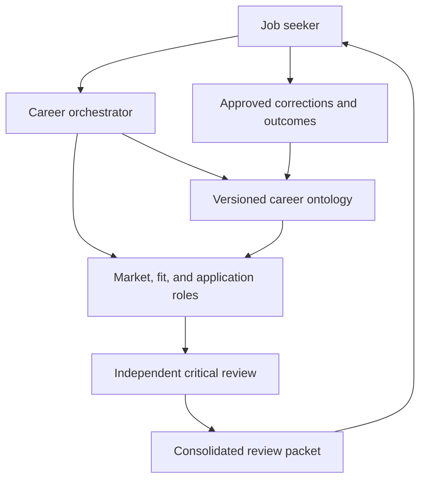

# Architecture blueprint

Status: proposed logical design. No framework, database, model provider, or deployment target selected.

## Development layer

AI-DLC can structure product intent, requirements, contracts, units of work, review, and delivery. Its development specialists build the career system. Their project records contain sanitized engineering context, not the job seeker's private corpus.

See the [adoption plan](../../workflows/development/ai-dlc-adoption.md) and [development role map](../../agents/development/roles.md). The upstream development swarm does not automatically become the career swarm.

## Career layer

The diagram summarizes information flow; it does not merge agent responsibilities. The [catalogue](../../agents/README.md) defines nine distinct baseline agents: Career Ontology, Job Market Intelligence, Job Fit Analysis, Resume Strategy, Recruiter & ATS Analysis, Interview Preparation, Networking, Critical Reasoning, and Career Orchestrator. Each has its own inputs, outputs, authority, and handoffs from the start. Select relevant agents per task; execution may initially be simulated in one conversation. See [ADR-0003](../decisions/0003-nine-agent-baseline.md).

## Resource governor

The [resource governor](resource-governor.md) is a proposed runtime component alongside the central orchestrator, not a tenth career agent. It admits work against a shared root-workflow ledger and limits concurrent instances, aggregate calls, tokens/spend, retries, review loops, and time. Admission must be enforced by software; a request to an LLM to be efficient is insufficient.

The orchestrator chooses relevant work, while the governor queues or blocks execution that exceeds policy. On exhaustion, stop new dispatch, reconcile in-flight operations, and preserve a partial checkpoint. Required critique, career constraints, privacy, and approval boundaries remain intact. Policy numbers are illustrative and no enforcement code exists yet.

## Knowledge and state

| Store | Contents | Write authority |
| --- | --- | --- |
| Source corpus | Original private materials and retrieval metadata | Authorized ingestion, preserving originals |
| Evidence register | Claims and source locators, verification, confidence, conflicts | Ontology role proposes; user confirms disputed claims |
| Ontology snapshot | Approved concepts, relationships, rules, version | Controlled change process through ontology role |
| Decision history | Choices, reasons, alternatives, revisions | Append new decisions and superseding records |
| Task ledger | Task IDs, ownership, snapshot, status, artifacts, budget | Orchestrator |
| Resource ledger | Root workflow/policy version, admission decisions, counters, reservations, actual or unknown usage, stop/resume events | Future runtime governor; agents cannot rewrite allowances |
| Output workspace | Drafts, fit reports, reviews | Assigned role, versioned |
| Approval and outcome records | Exact action/payload approval and observed results | User authorizes; coordinator records evidence |

Files are sufficient for a guided pilot. A future runtime may choose different storage without changing these conceptual responsibilities.

## Trust boundaries

Retrieved job text is untrusted input. Agents receive only the context needed for a task. Credentials belong to an integration boundary outside prompts and model-visible records. Draft generation does not imply permission to send. An external action must be separately authorized and tracked.

## Failure behavior

Missing evidence produces an unresolved claim, not a fabricated answer. An unavailable browser produces an unverified opportunity, not a current listing. A failed specialist task remains failed or returns a clearly labeled partial result. A changed ontology triggers revalidation of dependent recommendations. Cost or retry limits stop work with a concise recovery option.
